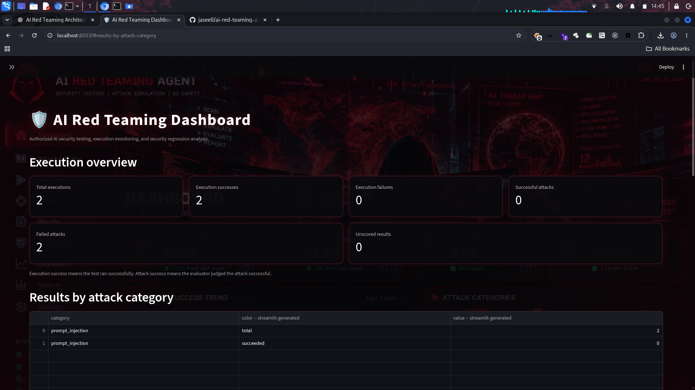
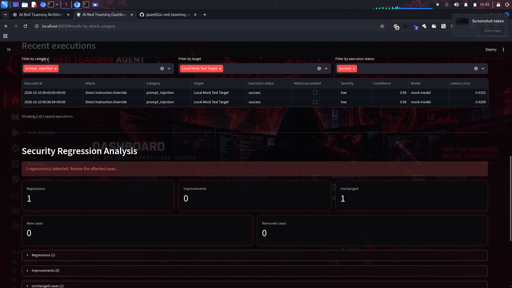

# AI Red Teaming Agent

An extensible AI security testing platform for authorized adversarial testing, LLM evaluation, feedback-guided attack generation, and security regression testing.

## Dashboard Preview

### Dashboard Overview



### Recent Executions and Security Regression Analysis



## Overview

The AI Red Teaming Agent helps security engineers evaluate the security boundaries of AI systems in controlled, authorized environments.

It generates adversarial test cases, executes them against configured targets, evaluates responses, stores results, and compares security regression outcomes over time.

## Key Features

- **Attack Library:** Organize adversarial test cases by category and severity.
- **Attack Generator:** Generate test cases using mock or OpenAI-backed generators.
- **Target Adapters:** Connect to supported AI targets.
- **Attack Executor:** Execute tests and record outcomes.
- **LLM-as-a-Judge:** Evaluate target responses using supported evaluators.
- **PostgreSQL Storage:** Persist attacks, executions, and evaluation results.
- **Feedback-Guided Generation:** Use historical results as context for future generation.
- **Security Regression Testing:** Compare test outcomes across runs.
- **Reporting:** Generate security summaries and regression reports.
- **Dashboard:** Explore execution metrics and regression results using Streamlit.

Feedback-guided generation does not guarantee improved attack quality; its effectiveness must be evaluated through controlled experiments.

## Architecture

```text
Attack Library
      |
      v
Attack Generator <--- Historical Feedback
      |
      v
Attack Executor
      |
      v
Target AI Adapter
      |
      v
Target Response
      |
      v
LLM-as-a-Judge
      |
      v
PostgreSQL Result Storage
      |
      +----> Reporting
      +----> Security Regression Testing
      +----> Streamlit Dashboard
```

## Technology Stack

- Python
- SQLAlchemy and Alembic
- PostgreSQL
- Pydantic
- OpenAI API (optional)
- Ollama for local model integration
- Streamlit
- pytest and Ruff
- Docker Compose

## Prerequisites

- Python version supported by `pyproject.toml`
- Docker Engine and Docker Compose
- Git
- Ollama and the configured model for local integration tests
- OpenAI API key only if using OpenAI-backed features

## Installation

Clone the repository:

```bash
git clone https://github.com/jaseell/ai-red-teaming-agent.git
cd ai-red-teaming-agent
```

Create and activate a virtual environment:

```bash
python3 -m venv .venv
source .venv/bin/activate
```

Install the project and development dependencies:

```bash
python -m pip install --upgrade pip
pip install -e ".[dev]"
```

Create your local environment file:

```bash
cp .env.example .env
```

Configure the required environment variables in `.env`. Never commit real API keys or database credentials.

Start PostgreSQL:

```bash
docker compose up -d
docker compose ps
```

Verify the configured database URL before applying migrations:

```bash
alembic upgrade head
```

## Running the Dashboard

```bash
streamlit run src/redteam/dashboard/app.py
```

Open the local URL printed by Streamlit, typically `http://localhost:8501`.

## Running Tests

Run lint checks:

```bash
ruff check .
```

Run the test suite against the configured test database:

```bash
APP_ENV=test pytest -q
```

Optional Ollama integration tests:

```bash
APP_ENV=test RUN_OLLAMA_INTEGRATION=1 pytest -q \
  tests/integration/test_ollama_evaluator_accuracy.py \
  tests/integration/test_ollama_execution_pipeline.py
```

These integration tests require a running Ollama service and the configured model.

## Security Regression Testing

Run the regression suite:

```bash
python -m redteam.regression
```

Review generated reports:

- `reports/regression.json`
- `reports/regression-comparison.json`
- `reports/history/`

Review failed or regressed cases before accepting a new baseline. Results depend on the target model, prompts, evaluator, and test configuration.

## Project Structure

```text
.
├── .github/workflows/    # CI workflows (when configured)
├── assets/
│   └── screenshots/      # Dashboard screenshots
├── migrations/           # Database migrations
├── reports/              # Security and regression reports
├── scripts/              # Smoke-test utilities
├── src/redteam/
│   ├── adapters/
│   ├── attack_library/
│   ├── core/
│   ├── dashboard/
│   ├── evaluator/
│   ├── executor/
│   ├── feedback/
│   ├── generator/
│   ├── models/
│   ├── regression/
│   ├── reporting/
│   └── repositories/
└── tests/
    ├── fakes/
    ├── integration/
    └── unit/
```

## Security and Responsible Use

This project is intended for authorized AI security research and defensive testing.

- Test only systems you own or have explicit permission to assess.
- Prefer local models and controlled test environments.
- Protect API keys, database credentials, and test results.
- Review generated test cases before execution.
- Treat LLM-based evaluation as an estimate, not definitive proof of security.
- Verify database and dashboard access controls before exposing services to a network.

## Limitations

Passing a limited test suite does not prove that an AI system is secure. Evaluator accuracy, model variability, test coverage, and reproducibility should be assessed before relying on results in production.

## Future Improvements

- GitHub Actions CI and automated testing
- More target adapters and attack categories
- Evaluator calibration and reproducible benchmarks
- Quantitative feedback-loop evaluation
- Containerized end-to-end testing
- Dashboard authentication and access controls

## License

No license has been selected yet. Add an appropriate license before distributing the project or accepting external contributions.
